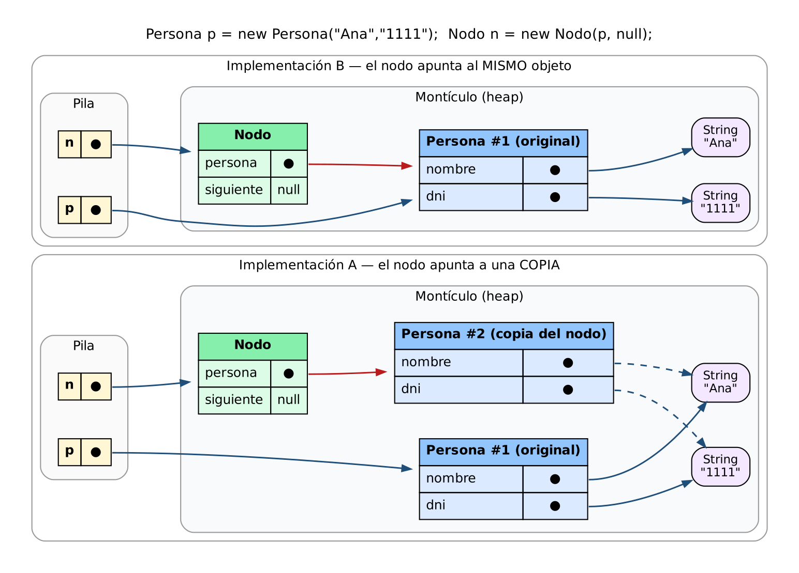
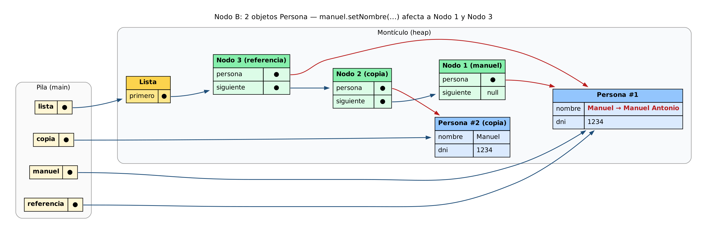
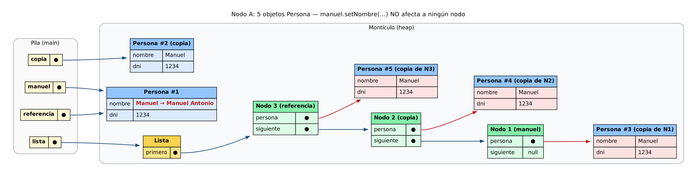
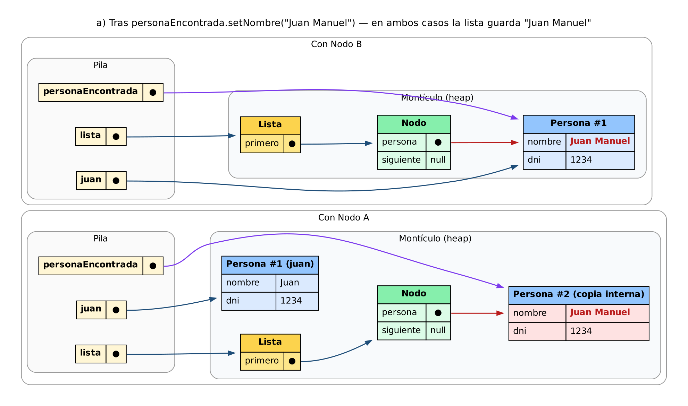
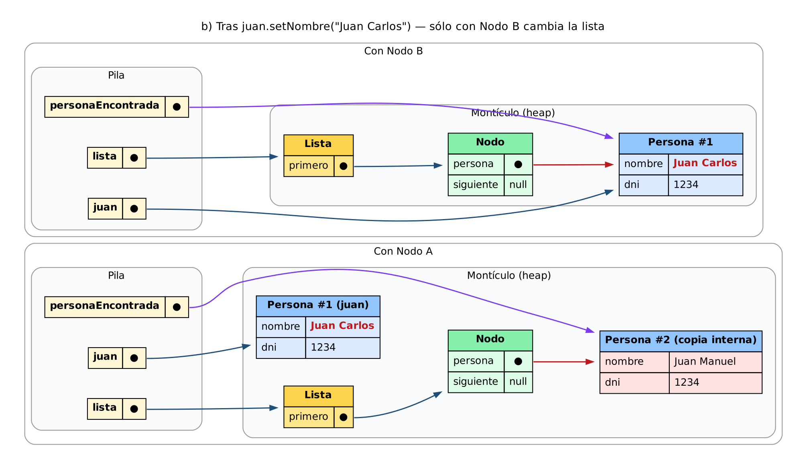
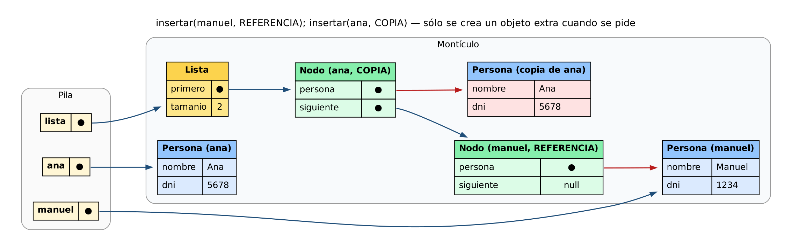
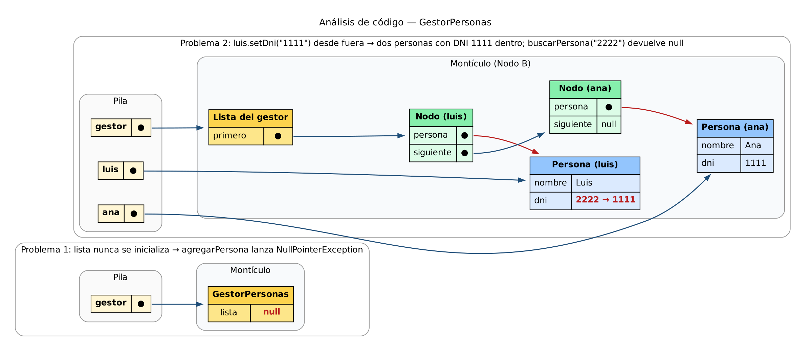

# Respuestas del examen

**Supuesto:** el código entregado no define `getNombre()`, `getDni()`, `setNombre()`, `getPersona()` ni `getSiguiente()`, así que tal cual no compila. Asumo getters que devuelven la referencia del atributo.

---

## 1. Análisis de implementaciones



### A. ¿Cuál usa mejor la memoria?

La **B**. Solo guarda una referencia al objeto existente. La A crea una `Persona` nueva en cada inserción, aunque sea la misma persona. Los `String` no se duplican en ninguna de las dos, porque la copia de A comparte las referencias.

### B. Problemas y ventajas

- **A**
  - Ventaja: aísla la lista de los cambios externos. Por ejemplo, `juan.setNombre("X")` no afecta a la lista.
  - Problema: copia campo a campo, así que pierde atributos nuevos y subclases.
  - Problema: `obtenerPersona` devuelve la copia interna, que se sigue pudiendo modificar.
- **B**
  - Ventaja: es barata y conserva la identidad del objeto (`obtenerPersona("1234") == juan`).
  - Problema: hay aliasing. Por ejemplo, `luis.setDni("1111")` desde fuera deja dos DNI iguales en la lista.

### C. Efecto en la lista

Con **A**, la lista es una "foto": los cambios externos no se propagan, pero se pierde la identidad de los objetos. Con **B**, la lista es una "vista": cualquier cambio externo se ve dentro, incluido el DNI, que es la clave de búsqueda. En ninguna de las dos `insertarPersona` evita duplicados.

---

## 2. Referencias y constructores

### a) ¿Cuántos objetos Persona hay?

- **Con Nodo B: 2.** Solo hay dos `new`, y `referencia = manuel` no crea ningún objeto.
- **Con Nodo A: 5.** A esos 2 se suman 3 copias, una por cada inserción.



### b) `manuel.setNombre("Manuel Antonio")`

La lista queda en este orden: referencia → copia → manuel.

- **Con Nodo B:** cambian los nodos de `manuel` y de `referencia`, porque los dos apuntan al mismo objeto. El de `copia` no cambia.
- **Con Nodo A:** no cambia ningún nodo, porque cada uno tiene su propia copia.



---

## 3. Gestión de referencias

### a) ¿Qué nombre tendrá la persona de la lista?

**"Juan Manuel"** con A y con B, porque `obtenerPersona` devuelve el objeto interno, no una copia. Con B también cambia `juan`. Con A, `juan` sigue siendo "Juan".



### b) `juan.setNombre("Juan Carlos")`

**Sí, depende del Nodo.**

- **Con B:** la lista muestra "Juan Carlos", porque es el mismo objeto.
- **Con A:** la lista no cambia, porque guarda una copia.



---

## 4. Diseño y optimización

- **Nodo de dos referencias**, como en la B, para no gastar memoria.
- **La lista decide si copia o guarda la referencia** en cada inserción. La copia usa `new Persona(p)`.
- **Detecta duplicados** por referencia (`==`) y por DNI.
- **`dni` es `final`**, así un objeto guardado por referencia no puede cambiar su clave.
- **Sin `HashMap`**: ahorra memoria a cambio de que la búsqueda sea O(n).

```java
enum ModoInsercion { REFERENCIA, COPIA }
enum Resultado { INSERTADA, MISMA_REFERENCIA, MISMO_DNI }

class Persona {
    private String nombre;
    private final String dni;

    public Persona(String nombre, String dni) {
        this.dni = Objects.requireNonNull(dni);
        this.nombre = nombre;
    }
    public Persona(Persona otra) { this(otra.nombre, otra.dni); }
    public String getNombre() { return nombre; }
    public String getDni() { return dni; }
    public void setNombre(String nombre) { this.nombre = nombre; }
}

class Lista {
    private static class Nodo {
        final Persona persona;
        Nodo siguiente;
        Nodo(Persona p, Nodo s) { persona = p; siguiente = s; }
    }
    private Nodo primero;

    public Resultado insertar(Persona p, ModoInsercion modo) {
        for (Nodo a = primero; a != null; a = a.siguiente) {
            if (a.persona == p) return Resultado.MISMA_REFERENCIA;
            if (a.persona.getDni().equals(p.getDni())) return Resultado.MISMO_DNI;
        }
        Persona guardada = (modo == ModoInsercion.COPIA) ? new Persona(p) : p;
        primero = new Nodo(guardada, primero);
        return Resultado.INSERTADA;
    }
}
```



---

## 5. Análisis de código



### a) Problemas

1. **`lista` nunca se inicializa**, así que el primer `agregarPersona` lanza `NullPointerException`.
2. **Entra la referencia sin proteger.** Por ejemplo, `luis.setDni("1111")` después de insertarlo deja dos DNI 1111 en la lista, y `buscarPersona("2222")` devuelve `null`.
3. **`buscarPersona` devuelve el objeto interno**, así que cualquiera puede modificarlo sin pasar por el gestor.

### b) Mejora

- Inicializar `lista`.
- Hacer copias defensivas al agregar (`new Persona(p)`) y al devolver.
- Permitir los cambios solo a través de métodos del gestor.

### c) Solución

Hacer `Persona` **inmutable**. Así compartir referencias es seguro y no hacen falta copias, lo que también ahorra memoria.

```java
public final class Persona {
    private final String nombre;
    private final String dni;

    public Persona(String nombre, String dni) {
        this.nombre = Objects.requireNonNull(nombre);
        this.dni = Objects.requireNonNull(dni);
    }
    public String getNombre() { return nombre; }
    public String getDni() { return dni; }
    public Persona conNombre(String nuevo) { return new Persona(nuevo, dni); }
}

public class GestorPersonas {
    private final Lista lista = new Lista();

    public boolean agregarPersona(Persona persona) {
        if (persona == null || lista.contiene(persona)) return false;
        lista.insertarPersona(persona);
        return true;
    }

    public Persona buscarPersona(String dni) {
        return lista.obtenerPersona(dni);
    }
}
```